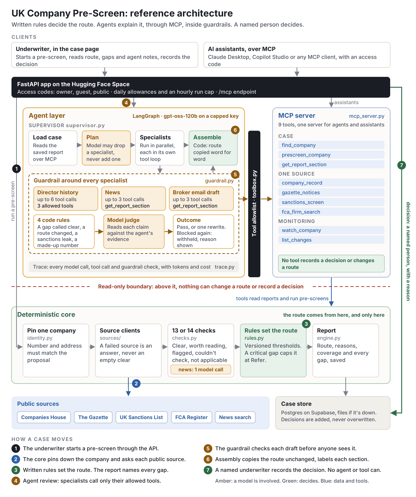
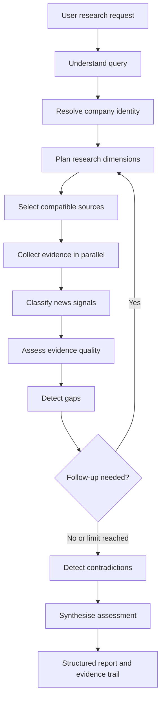

# UK company pre-screen for commercial underwriters

Before quoting a UK limited company, a commercial underwriter wants to know one thing:
is there anything on the public record that means I should refer this, decline it, or ask
the broker a question first? This app answers that in about a minute, on one screen, with
links to every source.

It recommends a route. The underwriter decides, and the decision and reason are kept with the report.

| Route | Meaning |
|---|---|
| Note only | Nothing on the record changes the route. Read the notes. |
| Refer | Needs a senior underwriter, or a question to the broker. |
| Outside appetite | Decline unless a senior underwriter overrides with reasons. |
| Compliance hold | A possible sanctions match on name and date of birth. Don't bind; compliance reviews it and decides. |

## What it checks

Every check ends in one of five states: **Clear**, **Info**, **Flag**, **Couldn't check** (with
the reason) or **Not applicable**. A check is Clear only when it actually saw everything: a source
that failed, a capped list, a truncated page or a news result nobody reviewed is "couldn't check",
never clear. If any of the critical checks couldn't run, the best a case can be is Refer.

| Check | Source |
|---|---|
| Identity: one Companies House number, or the user picks | Companies House |
| Status, strike-off (voluntary vs compulsory), registered office | Companies House profile, filing history |
| Age and name history (recent renames) | Companies House |
| Filings and accounts: overdue tiers, dormant vs trading, size vs declared turnover | Companies House |
| Insolvency: case record and Gazette notices (winding-up petitions) | Companies House, The Gazette |
| Charges: outstanding, new lenders in 12 months | Companies House |
| Directors / LLP members: disqualification (name + date of birth) | Companies House disqualified register |
| Directors: other companies that became insolvent (incl. liquidated then dissolved), phoenix pattern | Companies House appointments |
| Board and ownership changes in 12 months | Companies House |
| Ownership: PSCs, overseas owners by jurisdiction, one level of UK parent | Companies House PSC register |
| Sanctions: company, previous names, directors, PSCs, parent's owners | UK Sanctions List (FCDO), matched locally |
| FCA authorisation and disciplinary history (regulated trades only) | FCA Register |
| Adverse media, read against the company's identity | Brave Search (GDELT fallback) + one model call |
| Declared trade vs SIC codes (if given) | same model call |
| County court judgments | Not connected (paid source); always shown as not checked |

Thresholds live in `src/prescreen/rules.py`. Most are marked DRAFT: they are a starting point
from public guidance and need an underwriting authority holder to confirm them.

## Run it

```bash
python -m venv .venv && source .venv/bin/activate
pip install -r requirements.txt
cp .env.example .env          # USE_MOCK_DATA=true runs the offline demo cases
python api_server.py          # http://localhost:8000 opens the case page (the old page is at /old)
python -m pytest -q -m "not eval"
```

With `USE_MOCK_DATA=true` the app runs on two real Companies House profiles (Wilko 09563205 and
Monzo 09446231, captured 18 Oct 2026) and five invented companies that show each route and failure
mode (ZZ000001 to ZZ000004 and OC000005). Without a model key the news check can't run, so Wilko and
Monzo show "Couldn't check: Adverse media". That is the app being honest, not a fault.
For live data set `USE_MOCK_DATA=false` and the keys below.

| Variable | Needed for |
|---|---|
| `COMPANIES_HOUSE_API_KEY` | everything (free key) |
| `FCA_API_KEY`, `FCA_API_EMAIL` | FCA check (free registration) |
| `BRAVE_SEARCH_API_KEY` | news search (GDELT is used without it, ~3 months only) |
| `GROQ_API_KEY` (or `OPENAI_API_KEY`), `CHAT_MODEL_FAST=openai/gpt-oss-20b` | reading news results |
| `PRESCREEN_ACCESS_TOKEN` | optional access code for the API and UI; set it on any shared deployment |
| `PRESCREEN_RUNS_PER_HOUR` | service-wide cap (default 30) |

The Gazette and the UK Sanctions List need no key. Set `GAZETTE_ENABLED=false` only where The Gazette
refuses your server; it's then declared not covered instead of "couldn't check" on every run.

## Use it from an agent (MCP)

The same checks are an MCP server, so any MCP client (Claude Desktop or Code, a LangGraph or
OpenAI Agents app, Copilot Studio) can use them as tools.

| Tool | What it does |
|---|---|
| `find_company` | name or number → one company, or candidates for a human to choose |
| `prescreen_company` | full pre-screen with the proposal details; returns a ~3–5 KB summary and saves the report |
| `get_report_section` | one part of a saved report: checks, proposal, broker questions, timeline, news, company, file note |
| `company_record`, `gazette_notices`, `sanctions_screen`, `fca_firm_search` | one source each: evidence, not verdicts |
| `watch_company`, `list_changes` | daily re-check of the registers |

Also a `prescreen://rules` and `prescreen://checks` resource and a `prescreen_case` prompt.

What an agent can't do, by design: change the route (the rules decide it), record an underwriting
decision (a named person does that in the UI), or get sanctions-match detail on a compliance hold
(it's held for compliance, so nothing an agent drafts can tip off the broker). Every result that
has a gap says "not checked, which is not a clear result".

**Local (stdio)**, for example in Claude Desktop's `claude_desktop_config.json`
(on Windows: `%APPDATA%\Claude\claude_desktop_config.json`):

```json
{"mcpServers": {"uk-company-prescreen": {
  "command": "/path/to/agentic-uk-company-due-diligence/.venv/bin/python",
  "args": ["-m", "src.prescreen.mcp_server"],
  "env": {"USE_MOCK_DATA": "true",
          "PYTHONPATH": "/path/to/agentic-uk-company-due-diligence"}}}}
```

`command` must be the virtual environment's Python (on Windows `.venv\Scripts\python.exe`); a bare
`python` is whichever Python Claude Desktop finds first, which usually lacks the packages. `PYTHONPATH`
must be the project folder: Claude Desktop doesn't start the server there (a `cwd` setting didn't help on Windows, 26 Oct), so without it
the server exits at once with "No module named 'src'" and Claude Desktop shows "Server disconnected".
On Windows, write both paths with double backslashes.

**Remote (streamable HTTP)** at `https://<your-host>/mcp`, served by the same API. Send
`Authorization: Bearer <PRESCREEN_ACCESS_TOKEN>` when the token is set. On Hugging Face the
Space's host is allowed automatically (`SPACE_HOST`); elsewhere list hosts in `MCP_ALLOWED_HOSTS`.
MCP runs share the `PRESCREEN_RUNS_PER_HOUR` limit with the API.

## Sharing a demo

A deployment can serve three kinds of visitor (`src/prescreen/access.py`):

| Visitor | Sends | Can | Models |
|---|---|---|---|
| Owner | `PRESCREEN_ACCESS_TOKEN` | everything | `AGENT_PROVIDER` (may be paid) |
| Guest | a demo code from `PRESCREEN_GUEST_CODES` | run pre-screens and agent reviews on their own cases, within a daily allowance; read the examples | Groq free tier, or OpenRouter on its own capped key; never OpenAI |
| Anyone | nothing | open the example cases in `PRESCREEN_PUBLIC_EXAMPLES`, read-only, with their saved agent runs | none |

`python scripts/guest_code.py acme-jo --days 30` makes a code and prints the entry to add to
`PRESCREEN_GUEST_CODES`. Only the code's hash is stored; delete the entry to end it early.

A guest never runs on the owner's OpenAI key, and nothing falls back to it. `GUEST_AGENT_PROVIDER` is `groq`
(free tier) or `openrouter` (paid, through `OPENROUTER_API_KEY`); anything else, `off` included, switches guest
agent reviews off. Give the OpenRouter key a credit limit on OpenRouter: that limit is what protects money, since
the allowances below reset on restart. By default OpenRouter skips Groq as a host (`OPENROUTER_IGNORE`), whose
validator rejected gpt-oss generations in the guest checks. When the limit or budget is reached, the guest is told
agent reviews aren't available. Guest runs on live
data are marked "Demonstration" on the page and in the file note. Allowances (5 pre-screens and 2 agent reviews
a code a day, 40 and 10 across all guests by default) are counted in memory, so a restart resets them.
Watching, the watchlist, the old-graph evaluation and the legacy `/research/*` endpoints are owner-only. The MCP
endpoint accepts the owner code only.

Before giving guests agent reviews, run `.github/workflows/guest-model-check.yml`: the 9 evaluation companies
through the agents on the guest model, with sections finished, failed calls and timings.

## How it's built



Written rules set the route; agents explain it, through MCP, inside guardrails; a named person decides.
The diagram is explained on the [system page](https://www.ai-toolstack.com/projects/uk-company-prescreen/).

`src/prescreen/`: `identity.py` (the identity gate), `sources/` (one small client per source; a
source returns data, NOT_FOUND, or raises SourceError, never an empty "all clear"), `checks.py`
(plain functions over the fetched data), `rules.py` (thresholds and route), `media.py` (the only
model call), `engine.py` (fetches in parallel and runs the checks), `service.py` (wiring and storage).
`src/agents_v2/`: the agent layer. `supervisor.py` (a LangGraph graph: load case, plan, specialists
in parallel, assemble in code), `specialists.py` (three bounded tool loops), `toolbox.py` (each
agent's MCP tool allowlist; a call outside it never reaches the server), `guardrail.py` (four code
rules and an optional model judge; one rewrite, then withheld) and `trace.py`. The MCP server is
`src/prescreen/mcp_server.py`; none of its nine tools records a decision or changes a route.

The UI is `frontend/case.html`, served at `/` and `/case/<id>`. The previous page is kept at `/old`
and the original agentic research UI at `/legacy`, for comparison.

Why it was rebuilt, with the live runs that showed the problems, is in `docs/rebuild/`.

## Limits

- CCJs aren't checked (paid data).
- HSE and Environment Agency enforcement aren't connected yet.
- Reports are stored in Postgres when `SUPABASE_DB_URL` is set (as on the Space), otherwise as JSON
  files under `output/`, which a Hugging Face Space loses when it restarts.
- The sanctions screen is a name and date-of-birth match against the UK list only; it is a
  pre-screen, not a substitute for the insurer's own sanctions process.
- Registered societies (co-operatives) aren't covered: Companies House doesn't hold their directors
  or owners, so the tool says so and checks nothing.
- The public demo doesn't search The Gazette, which has refused requests from the Hugging Face Space
  since late October 2026. There it's declared not covered (`GAZETTE_ENABLED=false`), like CCJs, so a
  winding-up petition that appears in The Gazette before Companies House records an insolvency won't
  show on the demo. Local runs search it.
- Not a decision: the underwriter decides.

---

## Legacy: the agentic research graph

An evidence-driven, agentic research application for UK company due diligence
and insurance underwriting pre-screening.

The system resolves a company, plans the required research, collects evidence
from official and public sources, checks evidence quality, follows up on gaps,
detects contradictions, and returns a structured underwriting assessment with
an evidence trail.

This is a research framework, not an autonomous underwriting authority. Final
risk acceptance remains with an authorised human reviewer.

### What It Produces

- Canonical company identity and Companies House number
- Company, officer, filing, regulatory, news, fraud, and ownership summaries
- Five-part risk matrix
- Company-specific risk flags with supporting evidence
- Sanctions, disqualification, phoenix-company, enforcement, and PSC findings
- Referral triggers, possible exclusions, loading indicators, and decline indicators
- Missing dimensions, contradictions, research iterations, and evidence trace

### Research Flow



The graph is implemented with LangGraph. Agent outputs are validated with
Pydantic models, and connector failures are represented as missing evidence
instead of terminating the complete research run.

### Research Dimensions

| Dimension | Primary evidence |
|---|---|
| Company profile | Companies House company record |
| Officers | Companies House officer register |
| Filing history | Companies House filing history |
| Regulatory status | FCA Financial Services Register |
| News signals | Brave Search candidates classified by an LLM |
| Web evidence | Supplementary Brave Search results |
| Fraud signals | Director disqualification, appointment history, OpenSanctions |
| Beneficial ownership | Companies House PSC register and OpenSanctions |

### Technology

- Python 3.10+
- LangGraph and LangChain
- Pydantic v2
- FastAPI and Server-Sent Events
- OpenAI or Groq chat models
- Companies House, FCA Register, Brave Search, and OpenSanctions
- Pytest

### Quick Start

### 1. Create an environment

Windows:

```powershell
python -m venv .venv
.\.venv\Scripts\Activate.ps1
python -m pip install --upgrade pip
pip install -r requirements.txt
Copy-Item .env.example .env
```

macOS or Linux:

```bash
python -m venv .venv
source .venv/bin/activate
python -m pip install --upgrade pip
pip install -r requirements.txt
cp .env.example .env
```

### 2. Configure an LLM

Mock source data avoids external research API calls, but agent decisions still
require an LLM.

Groq example:

```ini
CHAT_MODEL_PROVIDER=groq
CHAT_MODEL=openai/gpt-oss-120b
CHAT_MODEL_FAST=openai/gpt-oss-20b
GROQ_API_KEY=your_key
USE_MOCK_DATA=true
```

OpenAI example:

```ini
CHAT_MODEL_PROVIDER=openai
CHAT_MODEL=gpt-4o
CHAT_MODEL_FAST=gpt-4o-mini
OPENAI_API_KEY=your_key
USE_MOCK_DATA=true
```

### 3. Start the application

```bash
python api_server.py
```

Open [http://localhost:8000](http://localhost:8000).

API documentation is available at
[http://localhost:8000/docs](http://localhost:8000/docs).

### 4. Run from the command line

```bash
python app.py --query "Create an underwriting assessment for Monzo Bank Limited"
```

### API

| Endpoint | Purpose |
|---|---|
| `GET /health` | Liveness check |
| `GET /` | Browser interface |
| `POST /research/sync` | Complete JSON response |
| `POST /research/stream` | SSE progress events and final assessment |
| `POST /research/chat` | Ask about an existing assessment without new research |
| `GET /docs` | OpenAPI interface |

Example synchronous request:

```bash
curl -X POST http://localhost:8000/research/sync \
  -H "Content-Type: application/json" \
  -d "{\"query\":\"Create a due diligence assessment for Monzo Bank Limited\"}"
```

### Live Data

The application starts with `USE_MOCK_DATA=true`. To use live sources:

1. Configure Companies House, Brave Search, and optional OpenSanctions keys.
2. Run `python scripts/check_apis.py`.
3. Set `USE_MOCK_DATA=false`.
4. Start a research request.

See [SETUP_REAL_APIS.md](SETUP_REAL_APIS.md) for source-specific instructions.

### Testing

Offline tests use mock evidence and do not call a real LLM:

```bash
python -m pytest -q -m "not eval"
```

Compile check:

```bash
python -m compileall -q src app.py api_server.py
```

LLM-backed evaluation uses mock source data but requires a configured model:

```bash
python scripts/run_eval.py
```

Run one evaluation case:

```bash
python scripts/run_eval.py monzo_full
```

### Configuration

| Variable | Default | Purpose |
|---|---|---|
| `CHAT_MODEL_PROVIDER` | `groq` in the example | LangChain model provider |
| `CHAT_MODEL` | Provider-specific | Quality-tier analytical model |
| `CHAT_MODEL_FAST` | Falls back to `CHAT_MODEL` | Faster planning/classification model |
| `USE_MOCK_DATA` | `true` | Use local source fixtures |
| `MAX_FOLLOWUP_ITERATIONS` | `2` | Maximum total research passes |
| `CONFIDENCE_THRESHOLD` | `0.6` | Guidance for evidence gap decisions |
| `CORS_ALLOWED_ORIGINS` | Local API origins | Comma-separated browser origins |
| `LANGCHAIN_TRACING_V2` | `false` | Enable optional LangSmith tracing |

All secrets are loaded through `src.config.settings`. Never commit `.env`.

### Project Structure

```text
src/
  agents/          LangGraph decision and analysis nodes
  connectors/      Raw API and mock-data access
  retrievers/      Source normalization into typed evidence
  api/             FastAPI application and endpoints
  evaluation/      Sample queries and structural validation
  graph.py         Workflow topology
  schemas.py       Pydantic contracts
  state.py         Shared AgentState
  prompts.py       Structured LLM instructions

frontend/          Browser interface
data/mock_sources/ Offline source fixtures
tests/             Offline unit and integration tests
scripts/           API checks and evaluation tools
docs/              Business and operational documentation
```

### Documentation

- [Business and functional guide](docs/BUSINESS_FUNCTIONAL_GUIDE.md)
- [Operational flow and system segregation](docs/OPERATIONAL_FLOW.md)
- [Live API setup](SETUP_REAL_APIS.md)

### Current Limitations

- Overall confidence is currently an LLM assessment, not a calibrated formula.
- Overall risk is not yet generated from an approved deterministic aggregation rule.
- Missing evidence can be difficult to distinguish from low risk in the risk matrix.
- Follow-up queries are planned, but targeted query text is not yet passed to retrievers.
- Entity resolution can continue when a company number is uncertain.
- The API has no authentication, rate limiting, or persistent case store.
- Public-source results and potential sanctions matches require human verification.

Do not use the output as a binding underwriting, legal, compliance, sanctions,
credit, or investment decision.

### ai·toolstack

This project is part of [ai·toolstack](https://www.ai-toolstack.com):
where AI demos become working systems.
